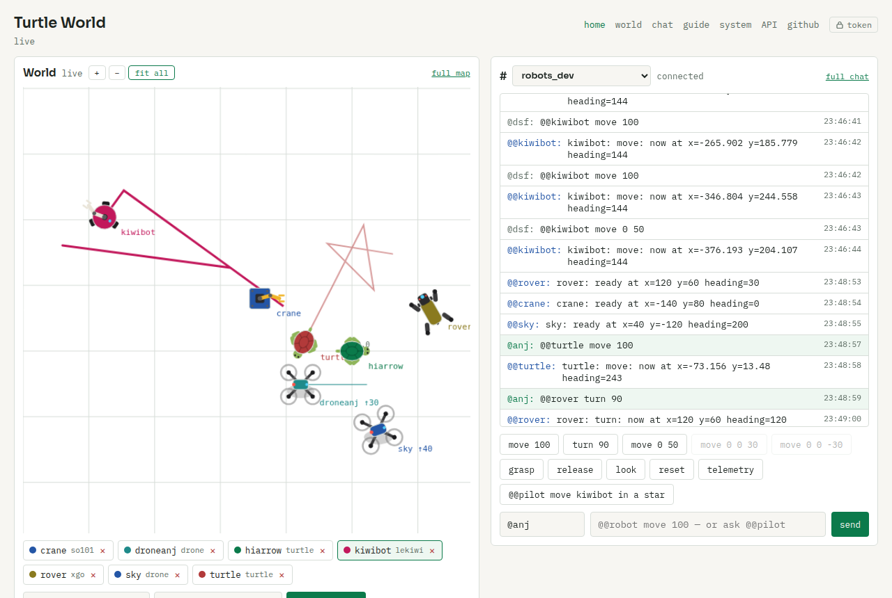

# aiko_turtle

Virtual robots in a shared world, for the AI+ML+Robots community to learn
and play with [Aiko Services](https://github.com/geekscape/aiko_services),
and a sandbox for the group's real robots. Anyone can create a robot that
speaks a *real* robot's interface (the iRobot Create 3's, the XGO dog's,
the LoliBot's, the June-2026 tutorial turtle's), drive it from the chat,
from a REST API, from an LLM agent or from their own Aiko code, and watch
every robot move in the browser. Real robots on the community broker
appear as twins. A live instance is at **https://turtle.aiko.hashtag.ai**
(the in-page [guide](https://turtle.aiko.hashtag.ai/guide) is the
friendliest start). `TURTLE_TITLE` renames the pages.



Built on the official, unmodified
[aiko_services](https://github.com/geekscape/aiko_services) and
[aiko_chat](https://github.com/geekscape/aiko_chat). Everything here is
application code; the shared services (MQTT broker, Registrar, HyperSpace,
ChatServer) run on the community instance **aiko.hashtag.ai**.

**Who this is for.** Beginners who want to see a robot move in ten
minutes, and developers who want to build agents and robots on a real
distributed framework. A virtual robot accepts exactly the functions and
units of the real robot whose interface it speaks, *as that robot's code
is today*, so what you write here plugs into the real XGO, iRobot or
LoliBot at the [meetup](https://www.meetup.com/ai-ml-robots/) with only
the discovery filter changed.

**How it was made.** Much of this code was written with an AI coding
assistant, with a human deciding what to build, reviewing it and running
it. The hard part is human work: Aiko Services has been developed over
years by Andy Gelme, who leads the AI+ML+Robots group, and the group's
study sessions are where the robot Interfaces used here are being worked
out. Those Interfaces are a work in progress (Aiko has the machinery for
defining them; which ones a robot should have is still being thought
through), so this project is one proposal, not the answer. Pull requests,
issues and ideas are welcome from everyone, whatever your level; the
"Contributing" section says where to start.

**Last tested with** aiko_services `39796ee` (2026-11-07) and aiko_chat
`9edb211` (2026-10-31), the heads of `master` and `main` at the time. The
aim is that it always works with the latest; if it does not, those are the
commits to compare against.

## How it fits together

| Process | What it is |
|---|---|
| `virtual_world.py` | **VirtualWorld** Actor: holds every robot's pose, persists them in a database, publishes them as the share `robots.<name>` |
| `robots/` | **the robot interfaces**, one plug-in module each: what a robot accepts on its `in` topic, how its chat is parsed, how the real one is recognised in the Registrar, how a command moves its twin, and the virtual robot that speaks it. `irobot` and `xgo_robot` are real robots' interfaces as they are; `turtle_robot` is the June-2026 tutorial's; `proposed` and `lolibot` are ours |
| `robot.py` | **the robot Actor**: one per robot, a `ChatBot` plus the interface's `Interface` and `Simulated` classes (`Robot_<interface>`), or a **twin** (`Twin_<interface>`) that forwards to a real robot and watches its topics. Its body is in the world; it is the robot's voice in the chat and its entry in the Registrar |
| `web.py` | **web server** (FastAPI): the pages (`/`, `/world`, `/chat`, `/guide`, `/system`), the REST API (`/docs`) and a live stream. It *hosts* a robot Actor for every robot created over REST, and a twin for every real robot it sees in the Registrar |
| `agent.py` | **LLM ChatAgent** `@@pilot`: discovers robots from Registrar tags and drives them in natural language. Rate limited |
| `mcp_server.py` | **MCP server**: the robots as tools for Claude Code, Claude Desktop or any MCP client, over the REST API |

Every robot in the world is always answerable in the chat and listed in
the Registrar:

- **Over REST / the page**: `POST /api/robots`. The web server hosts the
  robot's chat Actor, and re-hosts every robot after a restart.
- **Over Aiko, from any machine**: `./robot.py run --name NAME`. While
  your process runs, *it* speaks for the robot and the web server steps
  back; when it exits, the web server takes over again. So your own code
  (or a physical robot) can stand in for a virtual one at any time.

- **A real robot**: its own software registers with the Registrar, as
  it does today. The web server recognises it (by the name or protocol
  its `robots/` module matches) and creates a twin: a robot on the map,
  named after the real robot, that estimates its pose from the commands
  sent to it and the poses it reports, and forwards anything sent to the
  twin on to the real robot.

All three are the same thing: a row in the world's database and a
`<Chat>` Service in the Registrar, tagged `sandbox=virtual` or
`sandbox=twin` and `interface=<name>`.

Identity is deliberately not validated: pick any user name and any robot
name. If you do not want others driving your robot, pick a longer, more
unusual name.

## Install

```bash
git clone https://github.com/geekscape/aiko_services && pip install -e aiko_services
git clone https://github.com/geekscape/aiko_chat     && pip install -e aiko_chat
git clone https://github.com/anjsimmo/aiko_turtle    && cd aiko_turtle
pip install -r requirements.txt
cp .env.example .env          # optional: edit what you need
```

Python 3.12+. A venv or conda env is fine; `env.sh` warns if the `python3`
it finds lacks the packages. Set `AIKO_PYTHON_BIN` in `.env` to the `bin`
of your environment if you do not want to activate it each time.

## Configure

Everything is a variable with a default, read from the environment, then
`.env` (not committed), then `config.py`. See `.env.example`. The ones
you are most likely to touch:

| Variable | Default | |
|---|---|---|
| `AIKO_MQTT_HOST` | `aiko.hashtag.ai` | the shared services |
| `TURTLE_WORLD` | `turtle_world` | name of the VirtualWorld Service |
| `TURTLE_DATABASE_URL` | `sqlite:///turtle.db` | any SQLAlchemy URL; relative to the working directory, like HyperSpace storage |
| `TURTLE_CHANNEL` | `robots` | chat channel |
| `TURTLE_WEB_PORT` | `8123` | the web server binds `127.0.0.1` |
| `TURTLE_API_TOKEN` | *(empty)* | set it and every POST/DELETE on the REST API needs `Authorization: Bearer <token>`; reads and pages stay open |
| `TURTLE_API_TOKEN_PUBLIC` | `true` | show the token on the page and in `/guide`, pre-filled: a formality that keeps stray bots out, not developers. `false` to hide it |
| `OPENAI_API_KEY` | | the agent falls back to the `claude` CLI without it |
| `TURTLE_LLM_RATE_PER_MINUTE` | `10` | agent requests per minute (also `_USER_` per user, and `_QUEUE_LIMIT`) |

## Run

```bash
./start.sh      # world, web server, agent (logs in logs/)
./stop.sh
```

Or by hand, each in its own terminal, after `source env.sh`:

```bash
./virtual_world.py run
./web.py
./agent.py run
./robot.py run --name my_turtle      # a robot of your own, from anywhere
```

## Try it

Open **http://localhost:8123**. The world is on the left: create a robot
(pick a kind), click one to select it, use the quick-command buttons. The
`#robots` channel is on the right, with your name in the box (any name;
humans are `@name`, the page adds the `@`). The dropdown in the chat
header switches channels. `/world` is the map alone, `/chat` the chat
alone, `/guide` the human guide, `/system` the Registrar and MQTT details.

**REST** (interactive docs at http://localhost:8123/docs):

```bash
curl -X POST localhost:8123/api/robots -H 'Content-Type: application/json' \
     -d '{"name": "my_turtle", "kind": "turtle", "owner": "me"}'
curl -X POST localhost:8123/api/robots/my_turtle/turn -H 'Content-Type: application/json' \
     -d '{"angle": 90, "username": "me"}'
curl -X POST localhost:8123/api/robots/my_turtle/move -H 'Content-Type: application/json' \
     -d '{"distance": 100, "username": "me"}'
curl -X POST localhost:8123/api/robots/my_arm/command -H 'Content-Type: application/json' \
     -d '{"command": "grasp", "username": "me"}'   # any chat command: grasp, release, telemetry, ...
curl localhost:8123/api/robots                 # everyone's robots
curl localhost:8123/api/robots/my_turtle/history
curl -N localhost:8123/events                  # live poses + chat (SSE)
curl -X DELETE localhost:8123/api/robots/my_turtle
```

Every drive call returns the new pose. `GET /api/kinds` lists the kinds
and what each can do; `GET /api/chat/channels` the channels. With the
token, `/api/mqtt` watches a topic, streams one, or publishes to one, so
any Aiko Service can be called from a language with no Aiko client yet
(`/guide` has the three curl lines). The page's live stream is a
WebSocket at `/ws`; `/events` is the same as server-sent events.

**Chat** (the page, `aiko_chat repl` after `:cc robots`, or
`aiko_chat send robots "..."`):

```text
@@my_turtle move 100         ;; <Move>, replies with the new pose
@@my_drone move 100 0 30     ;; a vector: forward, left, up (as many axes as the kind has)
@@my_turtle turn 90          ;; degrees counter-clockwise
@@my_pi reset 100 -50        ;; put it there (any kind); plain "reset" = the origin
@@my_arm grasp               ;; <Grasp>, kinds with a gripper
@@my_turtle look             ;; <Perceive>
@@my_turtle telemetry        ;; <Telemetry>
@@my_turtle interfaces       ;; <Robot>
@@my_turtle reset            ;; the origin, or "reset X Y [H]" for anywhere
@@pilot move my_turtle in a star shape   ;; the LLM agent
```

Robots act only on messages that *start* with their `@@name`. Replies end
with ` !!!!`, the aiko_chat convention that stops bots answering bots.
Forget the `@@` and the page shows a reminder under the chat.

**Your own code** (the full power, from any machine; see `/guide`):

```bash
./robot.py run --name my_dog --kind xgo      # your process is the robot
python3 examples/aiko_drive.py my_dog        # discover it, call its <Move> directly
python3 examples/agent_bot.py                # a 60-line chat agent: @@square my_dog
python3 examples/rest_drive.py my_dog        # the same over REST, stdlib only
```

`examples/colab_turtle.ipynb` walks a beginner through both paths in
Google Colab (written for Colab, not yet run there: reports welcome).

**MCP** (Claude Code, Claude Desktop, any MCP client), no Aiko needed:

```bash
pip install mcp
claude mcp add turtle -e TURTLE_URL=https://turtle.aiko.hashtag.ai -- python3 $PWD/mcp_server.py
```

## Robots: interfaces and kinds

Two things describe a robot. Its **kind** is the body: the sprite and
how many axes `move` has. Its **interface** is what it speaks: the
functions on its `in` topic, the chat words, the units, the protocol it
registers with. Each kind lists the interfaces it may speak, the real
robot's first; `GET /api/interfaces` and `GET /api/kinds` are the live
versions of these tables.

| interface | status | what it is | from |
|---|---|---|---|
| `irobot` | real | the Create 3 under aiko_irobot on Zebra2, registered as `robot`: `move` metres, `turn` degrees (+ = left), `drive`, `arc`, `goto`, `dock`, `led`, `beep`; queries `battery` `pose` `dock_status` `sensors` with a reply topic | `../zebra-robot/robot_client.py` |
| `xgo_robot` | real | the XGO dog's Actor: `move x\|y STRIDE_MM` and `turn DEG/S` continuous until `stop`, `action NAME` from its table, `arm`, `claw` | the aiko_chat XGO example |
| `turtle_robot` | legacy | the June-2026 tutorial turtle: `forward` `backward` `left` `right` `action` | `../old_tutorials` |
| `lolibot` | proposed | `forward\|reverse\|left\|right [SECONDS]`, `stop`, `led R G B`, `speed %`: the updated firmware in `lolibot_mp/` | `../od_micro_py_files`, 2018 words kept |
| `proposed` | proposed | the sandbox's `<Move>` `<Grasp>` `<Perceive>` `<Telemetry>`: `move` as a vector, `turn`, `stop`, `grasp`, `release`, `snapshot`, `get_telemetry` | `interfaces.py` |

| kind | what it is | interfaces it may speak |
|---|---|---|
| `turtle` | the classic drawing turtle | turtle_robot (the tutorial's, the default), proposed |
| `lolibot` | the OHC [LoliBot](https://openhardwareconf.org/wiki/LoliBot), and Jon Oxer's BeetleBot | lolibot, proposed |
| `xgo` | XGO robot dog (walks forward and sideways) | xgo_robot, proposed |
| `irobot` | iRobot Create 3 with a Pi on top | irobot, proposed |
| `lekiwi` | LeKiwi: LeRobot's omni base with an SO-101 arm | proposed |
| `so101` | LeRobot SO-101 arm: grasps, does not drive | proposed |
| `drone` | a generic quadcopter: `move` is forward, left, up | proposed |
| `pi` | a Raspberry Pi with display, speaker and mic: senses, does not move | proposed |

Real interfaces are described **as the robot's code is today**, not as a
future design might wish; the dangerous functions (`power_off`, `e_stop`,
`terminate`) are refused in the chat. The world is in centimetres, so an
iRobot's `move 1` is 100 units and an XGO's 100 mm stride is 10. Every
robot also takes the sandbox's own words, `help`, `place X Y [H]`, `join
CHANNEL`, and can be dragged on the map.

**The three layers.** The page's *send as* switch sends the same command
as a chat message, as the Aiko remote function call the chat makes
(`(move x 100)` on the Actor's `in` topic, with the Python that does the
same through a ServiceFilter), or as the raw MQTT message; the *on the
wire* log shows the selected robot's topics live. `GET
/api/robots/NAME/wire?command=...` is the translation.

**Trying it without a real robot.** `tools/fake_robot.py INTERFACE` runs a
stand-in that registers exactly as the real robot's software does (same
protocol, name and functions), and lets you choose what it reports:
`--telemetry none` (an XGO: nothing), `--telemetry pose` (the iRobot's
`(pose x y heading)` stream), `--telemetry odd` (a format the sandbox
does not know), `--drift 80` (wheels that slip, so dead reckoning and the
reported pose disagree), `--no-echo`. It is tagged with your world name so
only your sandbox twins it; `--like-real` drops the tag and every sandbox
on the broker, the production one included, twins it.

**Twins.** When a Service a module recognises appears in the Registrar,
the web server creates a twin named after it (`name_host` on a clash),
drawn with a dashed ring, dimmed when the robot goes away, hidden by the
*show real robots* toggle. Its pose is an estimate: you place it to line
it up with the room; the module's `observe()` dead reckons from every
command on the real robot's `in` topic (an iRobot `move 1` is 100 units,
an XGO `move x 100` walks at two strides a second until `stop`); a pose
the robot reports on `out` wins. Chat or the aiko/mqtt layers sent to the
twin go to the real robot, and its replies are relayed into the chat for
a few seconds. Swapping a simulated robot for the real one is then only a
change of discovery filter: the guide's section 7 walks through it.

**Adding a robot** is one module and, for a new body, one sprite; nothing
else is edited, the registry lists the package:

1. Copy `robots/_template.py` to `robots/NAME.py` and fill in the
   contract at the top of `robots/__init__.py`: `Interface` (abstract
   methods with docstrings, the spec people read), `Simulated` (the
   virtual robot, acting on `self.body`), `parse_command`, `COMMANDS`,
   `MATCH` (how the real one is recognised), `observe` (dead reckoning
   for the twin), `KINDS`/`FITS`.
2. `static/sprites/NAME.js`: `SPRITES.NAME = function (c, col) {...}`,
   top-down, nose along +x, about 40 px across.
3. `python3 -m pytest -q tests`: the registry test checks every module.

`tools/infer_interface.py NAME --code PATH | --watch TOPIC | --registrar
NAME | --notes TEXT [--write]` drafts the module with the LLM from a
robot's code or its traffic on the bus, for you to review; the Claude
Code skill `.claude/skills/add-robot` is the same recipe.

## Tests

```bash
python3 -m pytest -q tests      # 17 tests, well under a second, no broker needed
```

They cover the world maths and persistence, the chat command and LLM
output parsers, the rate limiter, the kinds, and the REST API (including
channels and the bearer token) against a fake backend.

## State

| What | Where | Owner |
|---|---|---|
| robot definitions and poses | `robots` table | the world |
| every command, who sent it, the resulting pose | `events` table (`/api/robots/NAME/history`) | the world |
| live poses | the share `robots.<name>` on the world's topic | the world |
| which robots the web server speaks for | `host` column = `web` | the world, written by the web server |

The world is the only writer. Restart anything and the robots are where
they were. Change the database with one variable (`TURTLE_DATABASE_URL`).

## Deploying on a server

[docs/deployment.md](docs/deployment.md) walks through the public
instance at **https://turtle.aiko.hashtag.ai** step by step: the
aiko_services production instance, `.env`, the three entries in
`${HOST}_supervisor.json` (from `supervisor.json.example`), nginx with a
Let's Encrypt certificate, DNS, and how to update it (`git pull`, then
`sudo systemctl restart aiko.service`). The web server binds localhost;
the proxy needs `proxy_buffering off` for the SSE endpoint.

## Files

| File | Purpose |
|---|---|
| `config.py` | settings: environment, then `.env`, then defaults |
| `db.py` | the `robots` and `events` tables (SQLAlchemy Core) |
| `world_model.py` | the world without Aiko: poses, maths, persistence |
| `virtual_world.py` | the VirtualWorld Actor |
| `interfaces.py` | the proposed `<Chat>` `<Robot>` `<Move>` `<Grasp>` `<Perceive>` `<Telemetry>` |
| `robots/` | the registry (`__init__.py`, with the module contract), `base.py` (Body, statuses, units), one module per interface, `_template.py` |
| `kinds.py` | a thin facade over the registry for the web app and the agent |
| `core.py` | LLM output parser, rate limiter, name rule |
| `robot.py` | the robot Actors: `Robot_<interface>` and `Twin_<interface>` (`./robot.py run`, `host_robot()`, `host_twin()`) |
| `lolibot_mp/` | the updated LoliBot MicroPython firmware for the `lolibot` interface (not yet flashed) |
| `tools/infer_interface.py` | drafts a `robots/` module from code, traffic or notes |
| `agent.py` | the LLM ChatAgent |
| `webapp.py` | the FastAPI app and routes (no Aiko; testable) |
| `static/` | the pages: `index.html` (also `/world`, `/chat`), `guide.html`, `system.html`; `sprites/` one drawing per kind |
| `mcp_server.py` | MCP server over the REST API |
| `examples/` | `rest_drive.py`, `aiko_drive.py`, `agent_bot.py`, `colab_turtle.ipynb`; `notebooks/`: the June-2026 tutorial notebooks with notes for running them against the sandbox in Colab |
| `tools/fake_robot.py` | a stand-in for a real robot: registers as the real one does, with the telemetry behaviour you choose, so twins can be tested without the robot |
| `web.py` | the Aiko-connected backend and server |
| `tests/` | pytest |
| `start.sh` `stop.sh` `env.sh` | local convenience |
| `supervisor.json.example` | ProcessManager definition entries |
| `docs/` | `deployment.md` (server setup and updates), `aiko.hashtag.ai/` (the landing page of the community host), the 2026-08-22 imagineering session report |

## Design notes

- **Real interfaces as they are.** The constitution in aiko_services
  (ADR-023 deny-by-default gates, ADR-025 aspect tags, ADR-028 one
  property per tag) is the direction, and the sandbox follows it where it
  can: plain `move=0` tags, no spaces in tag values, reply-to topics with
  `(item_count N)` then `(response ...)`, discovery by ServiceFilter not
  literal topics. But the robots we have speak what their code speaks
  now, so each `robots/` module describes an interface verbatim, with its
  units and quirks, and a virtual robot registers with the real robot's
  protocol so one filter finds both. For older robots, simpler is better.
- **Aspect tags.** A virtual robot registers with one tag per Interface
  where the interface has aspects, `chat=0 robot=0 move=0 perceive=0
  telemetry=0`, plus `sandbox=virtual|twin`, `interface=`, `botname=`,
  `channel=`, `kind=`, `commands=`, and `twin_of=<topic path>` on a twin.
  The agent discovers robots with `implements(tags, "Robot")`; a
  ServiceFilter can select on `tags=["move=0"]`, on `interface=xgo_robot`
  or on the protocol. A kind without `<Move>` simply has no `move=0` tag.
- **Twins estimate, they do not measure.** A twin's pose is dead
  reckoning from the real robot's `in` topic (the module's `observe()`),
  overridden by any pose the robot reports on `out` for ten seconds. The
  page says "twin" next to it so no one reads it as ground truth. The
  iRobot's Registrar protocol string was not observable (no robot was
  online), so that module matches by the Actor name `robot`; fix `MATCH`
  once seen.
- **The world integrates continuous motion.** Real interfaces drive at a
  velocity until `stop` (the XGO, the iRobot's `drive`, the LoliBot), so
  the world has `drive`/`stop` and a 10 Hz tick next to the instant
  `move`/`turn`, and a `pen` for the legacy turtle.
- **The Interfaces** follow the 2026-08-15 study-group design: `<Robot>`
  composed of `<Move>` (move, turn, stop), `<Telemetry>`, `<Perceive>`,
  and `<Grasp>` for the arms. As in that design, `move` takes a vector
  rather than a command per axis: a number is forward, `[forward, left,
  up]` in the robot's own frame does the rest, and the kind says how many
  axes it has (`axes` in `kinds.py`: a turtle 1, an omni base 2, a drone
  3). `<Navigation>` (move_to a landmark) is the obvious next one; the
  design's `walk`, `start`/`stop` for low-cost drones, and bumper-style
  triggers are open questions worth a discussion at the meetup.
- **One world process, one Actor per robot.** The earlier design (each
  robot a hyperspace collection of lazily started source/target
  processes, with an embedded ProcessManager) is in the git history. It
  was replaced because every known issue came from the process split.
- **Hosting.** The web server creates ChatRobotAgent Actors in its own
  process (Aiko Services supports several Services per process). One
  framework detail: discovery registered after the services cache has
  loaded gets no replay of known Services (a TODO in `share.py`), so
  `ChatRobotAgent.attach_known_services()` reads the cache itself.
- **Service ids are never reused.** `aiko.process.remove_service()`
  decrements the counter that also generates Service ids, so the next
  Actor created in the process would share a topic path with a live one
  and the two would hear each other's messages. `ChatRobotAgent.detach()`
  restores the counter. Worth an upstream fix.
- **Request/response from HTTP threads.** `web.py` calls the world with a
  per-request response topic and waits on a queue. Never do that on the
  Aiko event thread: the reply arrives on it.

## Contributing

Everything is welcome: a new robot kind, a better sprite, a tutorial, a
bug report, a question. Good first contributions:

- a `robots/` module for a robot you own (see "Adding a robot" above);
- flashing `lolibot_mp/` to a LoliBot and reporting what broke;
- running `examples/colab_turtle.ipynb` in Colab and reporting what broke;
- an example in another language against the REST API;
- `<Navigation>` or a 3D `<Move>` for the drone.

Open an issue or a pull request at
[github.com/anjsimmo/aiko_turtle](https://github.com/anjsimmo/aiko_turtle),
or bring it to the [AI+ML+Robots meetup](https://www.meetup.com/ai-ml-robots/)
([ai-ml-robots.github.io](https://ai-ml-robots.github.io/)), where the real
robots are.

## Known issues

- aiko_services' message dispatcher (process.py `topic_matcher`) matches
  `prefix/#` one level deep only and `+` patterns by their first and last
  token, so a handler for `aiko/#` never sees `aiko/host/pid/1/in`.
  Removing a wildcard handler also raises (`del` on a list). So `/api/mqtt`
  in `web.py` uses its own paho-mqtt client, same broker and credentials,
  and lets the broker do the matching. Both worth an upstream fix.

- Channel `robots` is not in the ChatServer's channel list (`:lc`); the
  server relays to any channel, so it works. Avoid the channel `robot`,
  which the server routes to XGO robots.
- The agent sends robot commands one second apart; order is kept because
  the world applies each instantly.
- No identity: anyone can drive any robot, by design for now.
- The real robots' interfaces were taken from their code, not from a live
  robot: no XGO, iRobot or LoliBot was on the broker while this was
  written. The iRobot's protocol string is unknown (matched by name);
  `lolibot_mp/` has not been flashed; a twin's dead reckoning speeds
  (XGO strides per second, LoliBot cm/s) are guesses to calibrate.
